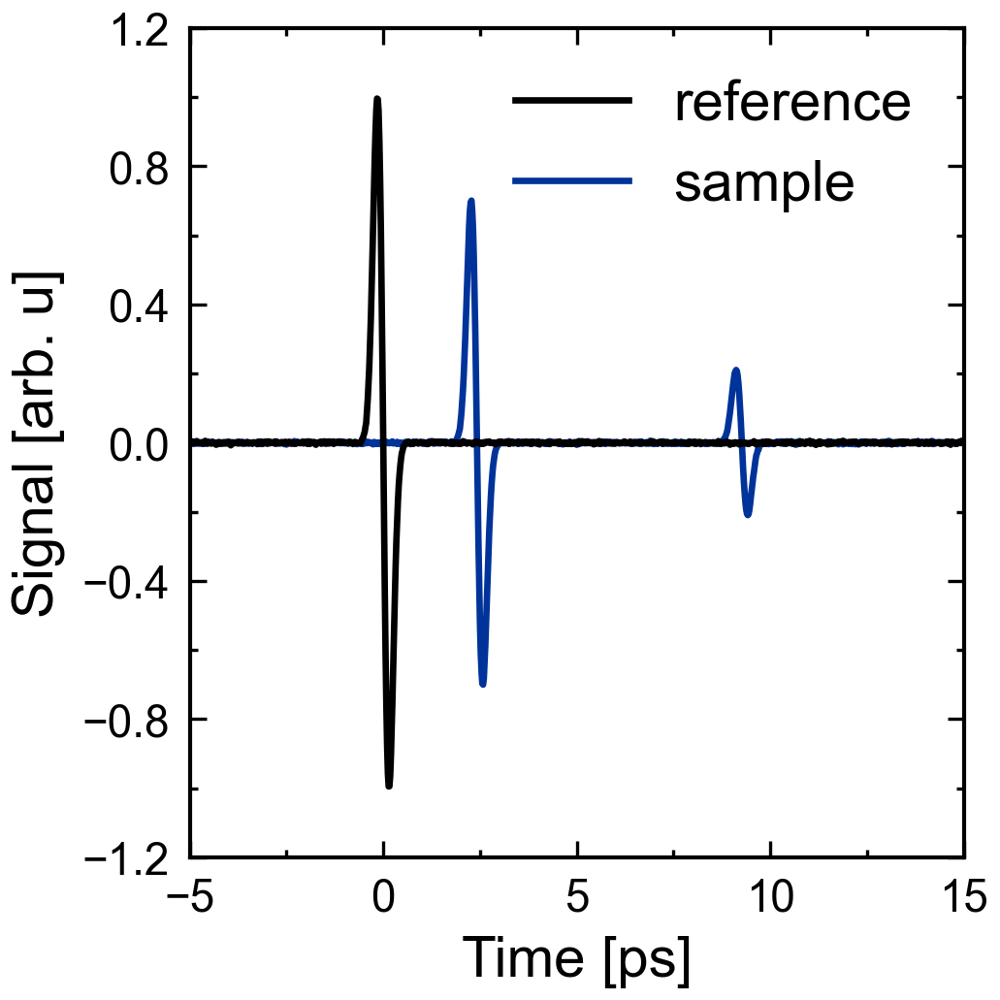
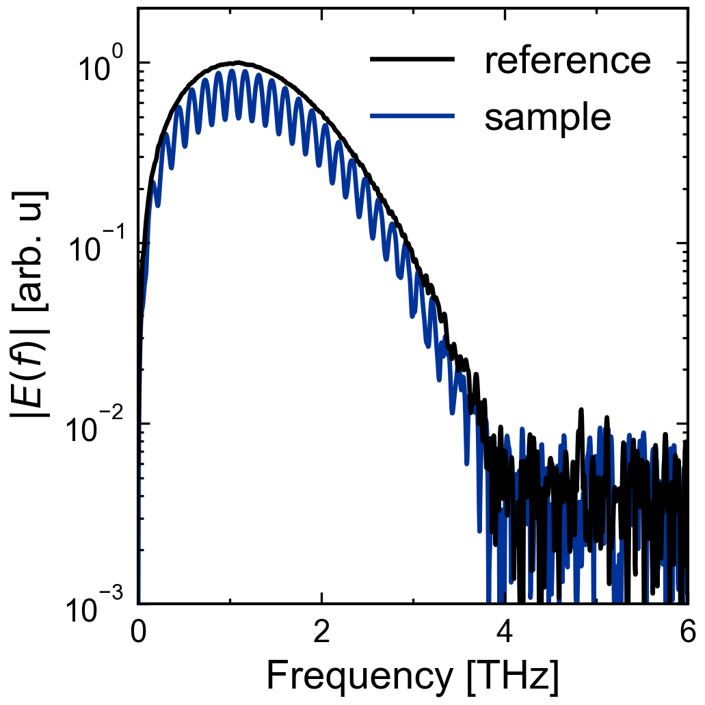
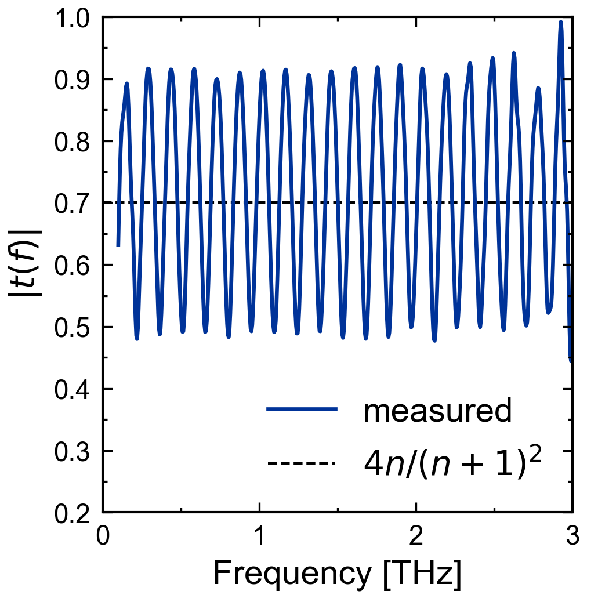
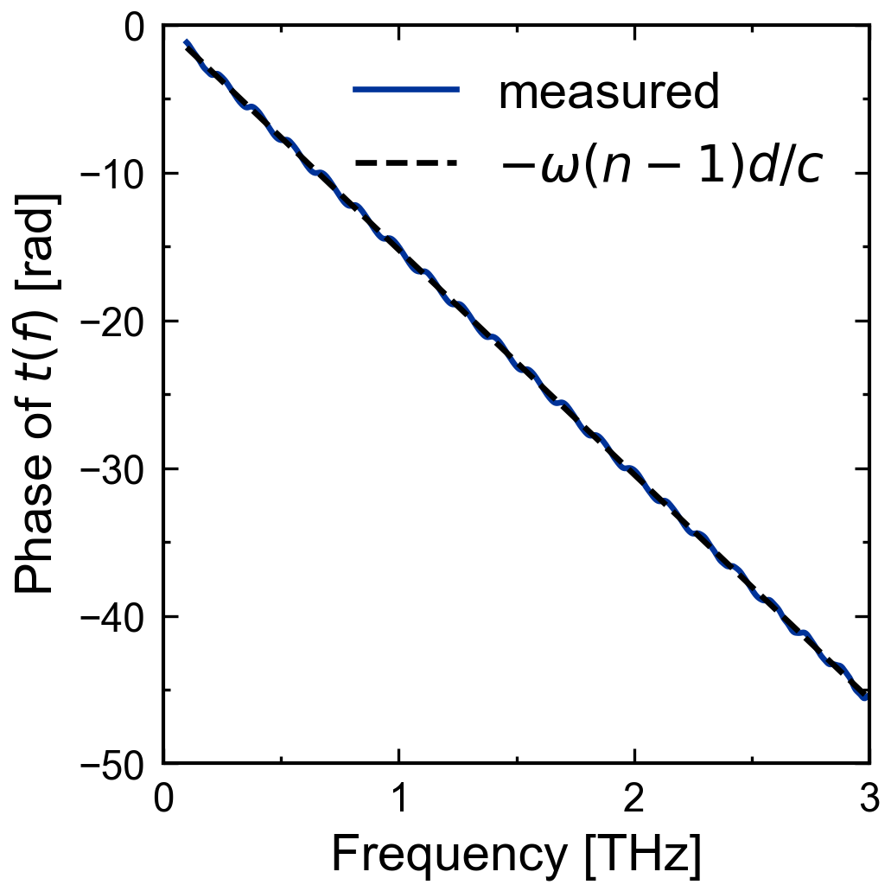
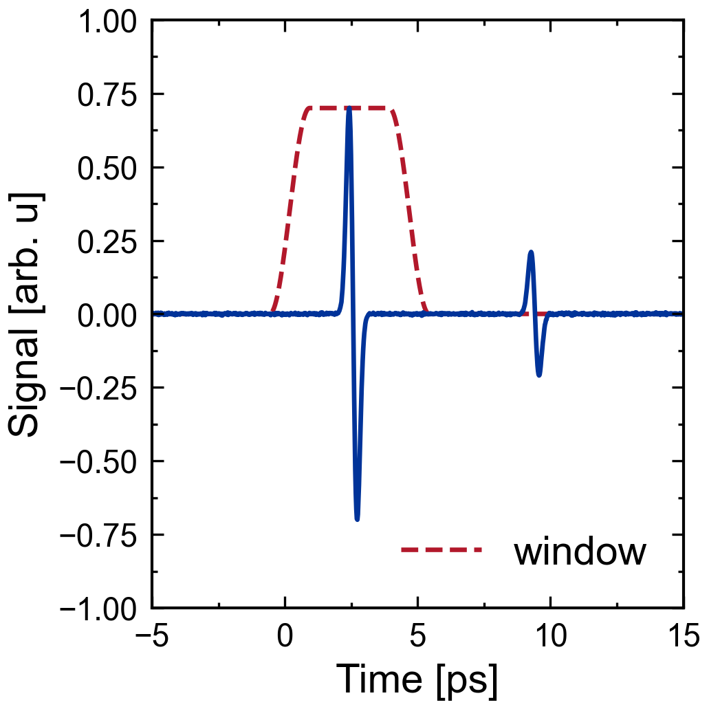
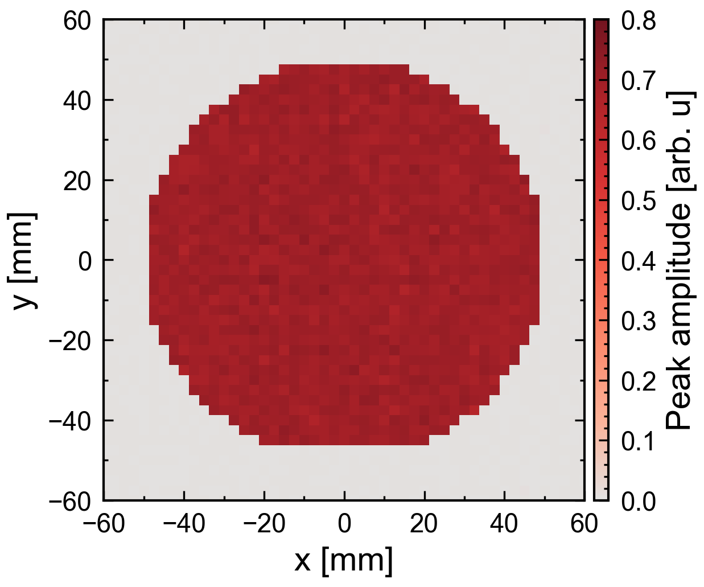

# cjcthztds

[](https://github.com/cjcscheper/cjcthztds/actions/workflows/tests.yml)
[](https://github.com/cjcscheper/cjcthztds/releases)

THz time-domain spectroscopy (THz-TDS) measurement processing: load the time
traces of a reference and one or more samples, and get their spectra and the
complex field ratio sample / reference, with every intermediate stage kept.

- **Instrument files in, a frozen `Analysis` out.** Menlo `.dat`, Toptica
  TeraFlash `.pulse.csv`, THz mapper `.tim.csv` raster scans and Astrella
  far-field exports are recognised automatically; adding a format is one
  file and one line.
- **Every stage kept:** the traces as loaded, on a common centred time axis,
  the windows, the windowed and zero-padded traces, the spectra, the field
  ratio and the power ratio, plus the settings used.
- **Scripted or interactive.** `analyze()` only computes; `run_analysis()`
  opens file dialogs, a window selector and a mapper window, plots the
  results and returns the same `Analysis`.
- **Measurement only.** No fitting, no material models: the field ratio and
  its frequencies are what a fit (with [cjctmm](https://github.com/cjcscheper/cjctmm)
  for the optics) starts from.
- **numpy and scipy** for the core; the interactive part needs matplotlib and
  [cjcplot](https://github.com/cjcscheper/cjcplot) (the `app` extra).

What each processing step does and why, and the sign convention of the
phase, are in [THEORY.md](THEORY.md).

## Install

```bash
pip install git+https://github.com/cjcscheper/cjcthztds.git
```

With the interactive part (file dialogs, windows, plots) and for the examples:

```bash
pip install "cjcthztds[app] @ git+https://github.com/cjcscheper/cjcthztds.git"
```

To pin a fixed version, so a script keeps giving the same numbers later on
(see [Releases](https://github.com/cjcscheper/cjcthztds/releases) and the
[changelog](CHANGELOG.md)):

```bash
pip install git+https://github.com/cjcscheper/cjcthztds.git@v0.1.0
```

For development, clone the repository and install it editable:

```bash
pip install -e ".[test,app]"
```

## Three ways to start

**1. Fully scripted:** files named in the script, nothing on screen.

```python
from cjcthztds import analyze, load_time_trace

reference = load_time_trace("air.dat")
sample = load_time_trace("silicon.dat")
analysis = analyze(
    [reference, sample],                 # the reference first (reference_index=0)
    window_regions_ps=[(-3.0, 6.0)],     # keep -3..6 ps around each pulse (reference peak at t = 0)
    padding_ps=50.0,                     # finer frequency grid; adds no information
    freq_min_hz=0.2e12, freq_max_hz=3e12,
)
analysis.freq_hz          # frequencies [Hz], shape (K,)
analysis.field_ratio[1]   # complex t(f) = E_sample / E_reference, shape (K,)
analysis.peak_times_ps    # [0, delay of the sample] in ps
```

**2. Pick the files in a dialog**, then the same as above:

```python
from cjcthztds import analyze, load_time_trace
from cjcthztds.app import select_files

paths = select_files()    # reference dialog, then sample dialog; reference first
analysis = analyze([load_time_trace(path) for path in paths], window_regions_ps=[(-3.0, 6.0)])
```

**3. Fully interactive:** dialogs, window selector (and the mapper window for
a `.tim.csv` scan), result plots. Press Run on `src/cjcthztds/app/run.py` in
PyCharm, or

```bash
cjcthztds-analyze
```

or `python -m cjcthztds.app.run`. From a script that goes on with the
numbers (a fit, say), skip the plots and keep the result:

```python
from cjcthztds.app import run_analysis

analysis = run_analysis(show_plots=False)
```

## Supported files

| Instrument                      | File                    | Read as                                                                                     |
|---------------------------------|-------------------------|---------------------------------------------------------------------------------------------|
| Menlo TDS                       | `*.dat`                 | `TimeTrace`; the `#` header lines in `metadata["header"]`                                    |
| Toptica TeraFlash               | `*.pulse.csv`           | `TimeTrace`; `signal_column=1` (default) or `2`                                              |
| THz mapper                      | `*.tim.csv`             | `TimeTraceMap` (`load_time_trace_map`), or one position with `load_time_trace(path, position=(iy, ix))` |
| Astrella far-field TDS          | no extension            | `TimeTrace`; recognised by a first line `ProbeDelay: ...`; `signal_channel="X"` (default), `"Y"` or `"R"` |

`load_time_trace(path, **options)` detects the format; the options are
passed to that format's loader. The Astrella delay column is an unreliable
stage readback, so the delay axis is rebuilt from the commanded grid in the
header (`delay_axis="grid"`, default; `"readback"` filters the readback
instead), negated (THz time = −probe delay) and put in increasing order.
`supported_formats()` lists the formats; each module in
`src/cjcthztds/formats/` documents its file layout.

**Adding a format:** copy `src/cjcthztds/formats/_template.py` to
`formats/<instrument>_<extension>.py`, fill in `DESCRIPTION`,
`FILE_PATTERNS`, `IS_MAP`, `detect(path)` and `load(path)`, and add the module
to the `FORMATS` list in `formats/__init__.py` (the list order is the
detection order). The file dialogs pick it up from there. Add a small test
file via `tests/generate_test_data.py`; a test fails until every registered
format has one.

## What `analyze` returns

`analyze(traces, ...)` returns a frozen `Analysis`. With `M` traces (row
`reference_index` is the reference), `N` samples on the common axis, `N_pad`
after padding and `K = N_pad // 2 + 1` frequencies:

| Field                                         | Shape            | Meaning                                                          |
|-----------------------------------------------|------------------|------------------------------------------------------------------|
| `traces`                                      | `M`              | the `TimeTrace`s as loaded (own time axes, paths, metadata)      |
| `time_ps`                                     | `(N,)`           | common uniform time axis, reference peak at t = 0                |
| `signal`                                      | `(M, N)`         | the traces on `time_ps`                                          |
| `reference_peak_time_ps`, `peak_times_ps`     | scalar, `(M,)`   | shift applied; each trace's peak = delay relative to reference   |
| `window`, `windowed_signal`                   | `(M, N)`         | window per trace (ones without regions), `signal * window`       |
| `padded_time_ps`, `padded_signal`             | `(N_pad,)`, `(M, N_pad)` | what was Fourier transformed                             |
| `freq_hz`                                     | `(K,)`           | 0 to the Nyquist frequency, in Hz                                |
| `spectrum`                                    | `(M, K)`         | complex spectrum of each trace (signal × s)                      |
| `field_ratio`, `power_ratio`                  | `(M, K)`         | `spectrum / spectrum[reference_index]`, and its magnitude squared |
| settings                                      |                  | `window_regions_ps`, `taper`, `center_on_peak`, `padding_ps`, `spline_half_width`, `freq_min_hz`, `freq_max_hz` |

`freq_min_hz` / `freq_max_hz` mark the usable band for plots and fits; they
never limit the computed arrays.

## Options of `analyze`

| Option              | Default | Meaning                                                                                          |
|---------------------|---------|--------------------------------------------------------------------------------------------------|
| `reference_index`   | `0`     | which trace is the reference                                                                     |
| `window_regions_ps` | `None`  | `[(start_ps, stop_ps), ...]` on the centred axis; a Tukey window per region. `None`: no window    |
| `taper`             | `0.5`   | fraction of each window in its cosine edges: 0 rectangle, 1 Hann                                 |
| `center_on_peak`    | `True`  | move each window (same width) onto the trace's own peak inside the region                        |
| `padding_ps`        | `0.0`   | ps of zeros added, half before and half after                                                    |
| `spline_half_width` | `5`     | samples on each side of the largest one in the cubic spline that finds the peak                  |
| `freq_min_hz`, `freq_max_hz` | `None` | usable band, stored for plots                                                           |

`run_analysis(...)` takes the same settings (its band defaults to 0.1–3.5 THz)
plus `show_plots`, `show_legends`, `show_window_selector_trace_difference`,
`field_ratio_separate_figures` and `show_peak_fits` (one figure per trace with
the samples around its peak, the spline through them and the peak found).

## Conventions

- Time in ps (`time_ps`), frequencies in Hz (`freq_hz`), `omega = 2π f` in
  rad/s; positions in mm (`x_mm`, `y_mm`).
- Lowercase `t`, `r` for complex field ratios, uppercase `T`, `R` for power.
  The package says **field ratio**, valid for transmission and reflection.
- **Sign convention:** the spectra use numpy's kernel `exp(−iωt)`, so a
  sample that delays the pulse by Δt has `field_ratio = a·exp(−iωΔt)`: the
  phase *falls* with frequency. cjctmm uses the opposite (physics)
  convention; compare with `solve_tmm(..., conjugate_model=True)`. THEORY.md,
  section 8, gives the exact recipe.

## Other functions

Each step is available on its own: `common_time_axis`, `find_peak` (maximum of a cubic
spline through the samples around the peak; returns a `Peak`), `peak_spline_curve` (that spline, for plotting), `center_on_reference_peak`, `peak_map` (peak
time and amplitude of every map position), `tukey_window`, `trace_window`,
`zero_pad`, `fourier_transform`, `compute_complex_field_ratio`, `frequency_range_mask`,
`unwrapped_phase`, `amplitude_spectrum(trace)` and `trace_at_position`.
`cjcthztds.app` has `select_files`, `select_reference_file`,
`select_sample_files`, `select_map_file`, `select_window_regions`,
`select_map_positions` (the mapper window), `plot_analysis`, `plot_peak_fit`
(the samples, spline and peak of one trace) and `run_analysis`.

## Examples

Each script in `examples/` makes synthetic traces (a single-cycle pulse and
the same pulse after a 0.3 mm silicon wafer), runs them through the package
and saves its figure next to itself. They plot with
[cjcplot](https://github.com/cjcscheper/cjcplot) and need the `app` extra,
which pins cjcplot to a release tag (now `v0.2.0`).

<!-- widths = fig_aspect_ratio[0] x 640 px, so all fonts appear at the same size. -->
<table align="center">
  <tr>
    <td></td>
    <td></td>
  </tr>
  <tr>
    <td></td>
    <td></td>
  </tr>
  <tr>
    <td></td>
    <td></td>
  </tr>
</table>
<p align="center">
  
</p>

## License

MIT, see [LICENSE](LICENSE).
